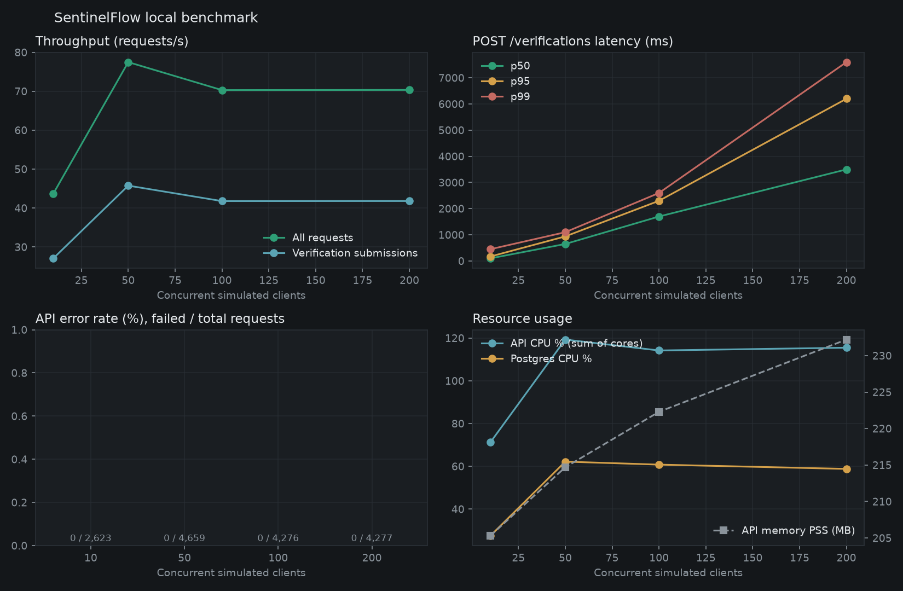

# SentinelFlow benchmark report

Measured 2026-11-12T14:30:12+00:00 on a single host. API, PostgreSQL, Redis and the Locust load generator all ran on the same machine, so these are **local measurements, not production capacity claims**.

## Environment

- 2 vCPU visible, but **1.9 effective cores measured** (parallel CPU-bound probe); 7.8 GB RAM, Linux-6.18.44-fc-v378-x86_64-with-glibc2.39
- All components share that CPU budget, so throughput plateaus once it is saturated and further clients only add queueing latency
- Python 3.13.18, PostgreSQL 16.15 (Ubuntu 16.15-0ubuntu0.24.04.1), Redis 7.0.15
- API: uvicorn with 2 worker processes; per-principal rate limit raised for the run
- Simulated providers: 40 ms ±50% latency, 5% outage rate, 1% timeout rate, 300 ms timeout, 2 retries
- Each level: ramp-up excluded (stats reset), then 60 s steady state

## Methodology

Clients are API-key integrations. Mix: 60% `POST /verifications` (full workflow: two concurrent provider calls with retries, risk scoring, policy evaluation, one transactional write of ~7 rows plus audit events), 20% list, 15% detail, 5% dashboard. Think time 50–250 ms per client. Provider chaos (5% outages, 1% timeouts) is on, so the retry path is part of the measured latency.

## Results by concurrency

| Clients | Total req/s | Submissions/s | Submit p50 | Submit p95 | Submit p99 | All p95 | Error rate | API CPU avg | API memory (PSS) |
|---:|---:|---:|---:|---:|---:|---:|---:|---:|---:|
| 10 | 43.69 | 27.08 | 100.0 ms | 170.0 ms | 450.0 ms | 150.0 ms | 0.00% | 71.2% | 205.3 MB |
| 50 | 77.48 | 45.76 | 650.0 ms | 940.0 ms | 1100.0 ms | 880.0 ms | 0.00% | 119.3% | 214.7 MB |
| 100 | 70.3 | 41.79 | 1700.0 ms | 2300.0 ms | 2600.0 ms | 2100.0 ms | 0.00% | 114.2% | 222.3 MB |
| 200 | 70.34 | 41.81 | 3500.0 ms | 6200.0 ms | 7600.0 ms | 5600.0 ms | 0.00% | 115.5% | 232.2 MB |

CPU percentages are summed across processes (100% = one core). Memory is proportional set size, so shared pages are not double-counted.

## Derived from stored data (benchmark organization only)

- Provider calls: 20,430; calls that hit a transient failure: 681; recovered by retry: 681 → **provider failure recovery rate 100.0%**
- Provider calls still failing after retries: 0.00% (routed to manual review by policy, never auto-approved)
- Workflow end-to-end (server-side): p50 401.3 ms, p95 1802.428 ms, p99 3072.87 ms over 10,215 runs
- Policy evaluation inside workflows (8 policies): p50 0.09 ms, p95 0.15 ms
- Policy engine micro-benchmark: 15.96 µs per evaluation of 8 policies (median of 5×20,000)
- Watchlist screening cache (tenant-scoped, 1 h TTL, 400-identity pool): hit rate 80.6% (8,230 hits / 1,985 misses)

## Database query latency (serial, idle system)

Table size at measurement: 47,368 verification requests.

| Query | p50 | p95 | p99 |
|---|---:|---:|---:|
| tenant scoped lookup by id | 0.708 ms | 1.078 ms | 1.238 ms |
| verification list page join | 4.56 ms | 6.112 ms | 9.429 ms |
| verification detail children | 1.107 ms | 1.813 ms | 3.02 ms |
| dashboard aggregates | 18.386 ms | 19.863 ms | 20.873 ms |

## Test coverage

Backend line coverage: **94.2%** (147 backend tests, 12 frontend component tests, 8 Playwright end-to-end tests)

## Reproduce

```bash
cd backend && pip install -r requirements-dev.txt
python ../benchmarks/run_benchmarks.py --levels 10 50 100 200 --duration 60
```


